# 🎬 ChopzCinema Shaders

**A cinematic shaderpack for Minecraft 1.20.1, made for Oculus/Iris and Distant Horizons.**

ChopzCinema aims to make Minecraft look like a feature film: strong light and shadow, a film look with inky blacks and rich colours like a modern blockbuster, volumetric clouds, fog, god rays, a real starry sky with northern lights, and rain that feels like a movie scene.

> **Status:** v0.7, in development. Tested in-game with Forge 47.4.20, Oculus 1.8.0, Embeddium 0.3.31 and Distant Horizons 3.2.0 in a freshly generated world. Every screenshot below was taken during that test.

---

## Screenshots

*All images are real in-game screenshots (F2) with the default profile and Distant Horizons enabled.*

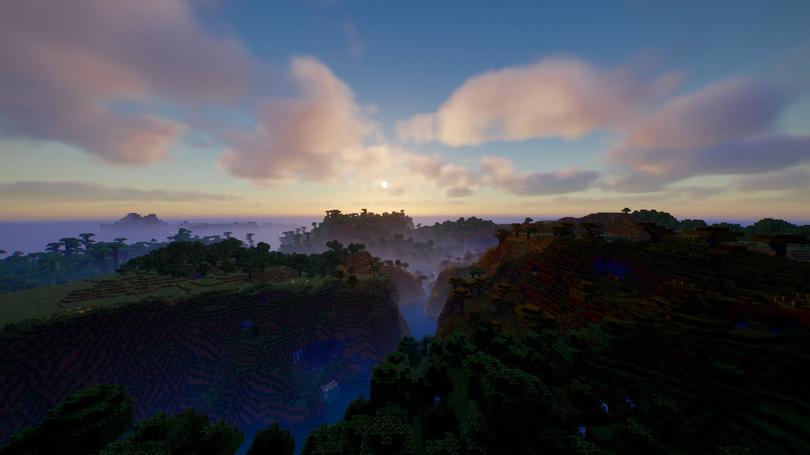
*Sunset: mist in the valley, lit clouds, "Brand New Day" film grade*

| | |
|---|---|
| 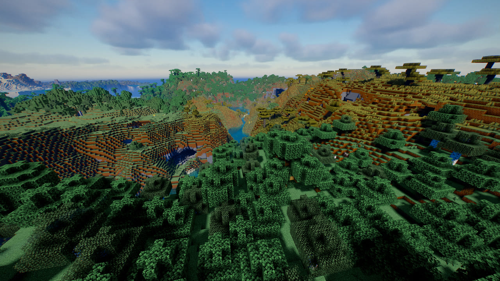 | 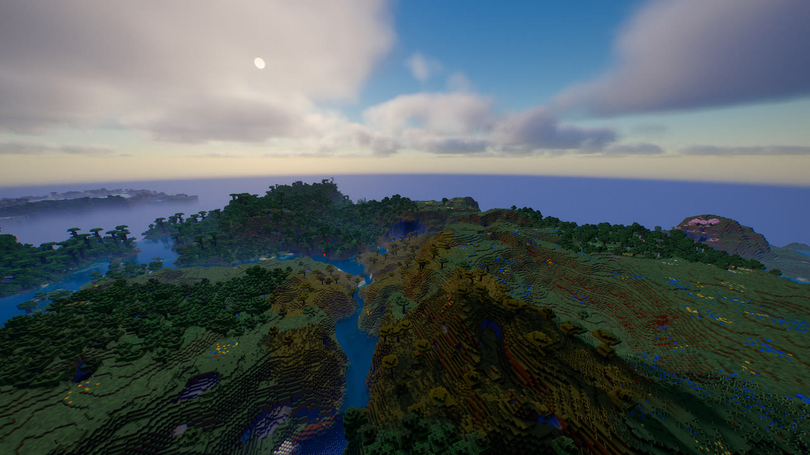 |
| **Day**: hard sunlight, deep shadows | **Distant Horizons**: LODs all the way to the horizon |
| 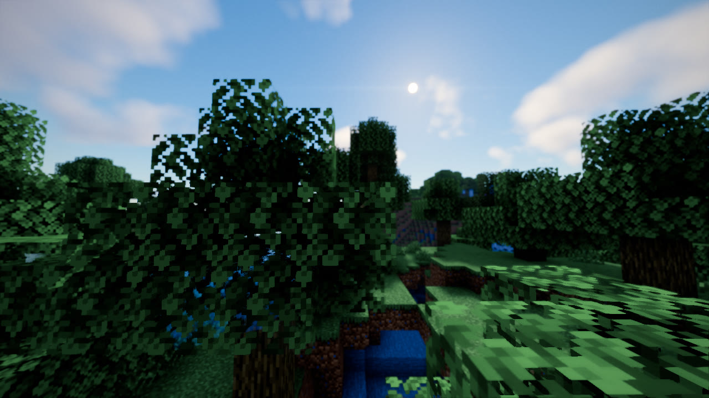 | 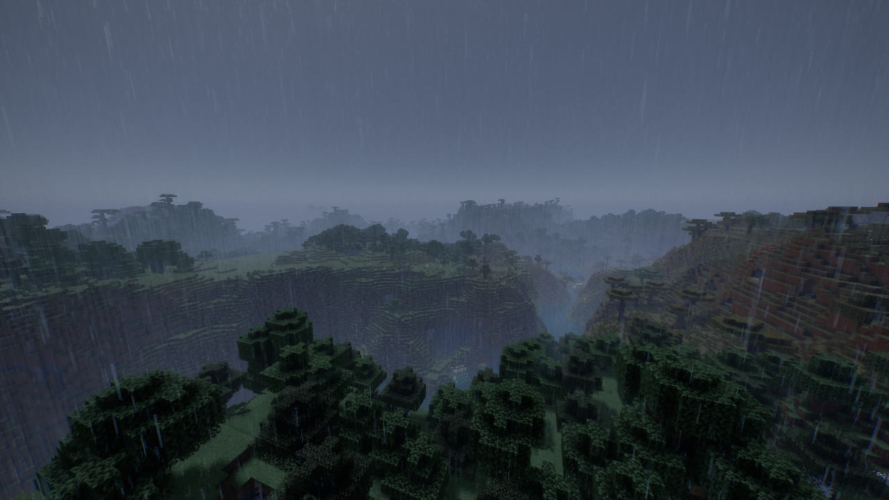 |
| **Forest in the morning**: depth of field, lens flare | **Thunderstorm**: rain streaks, rain curtains, film mood |
| 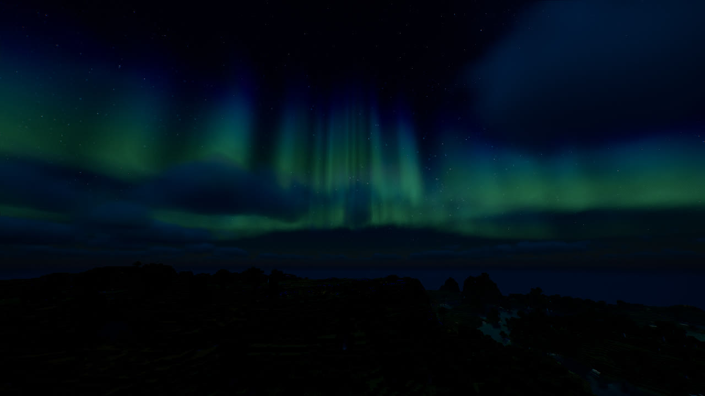 | 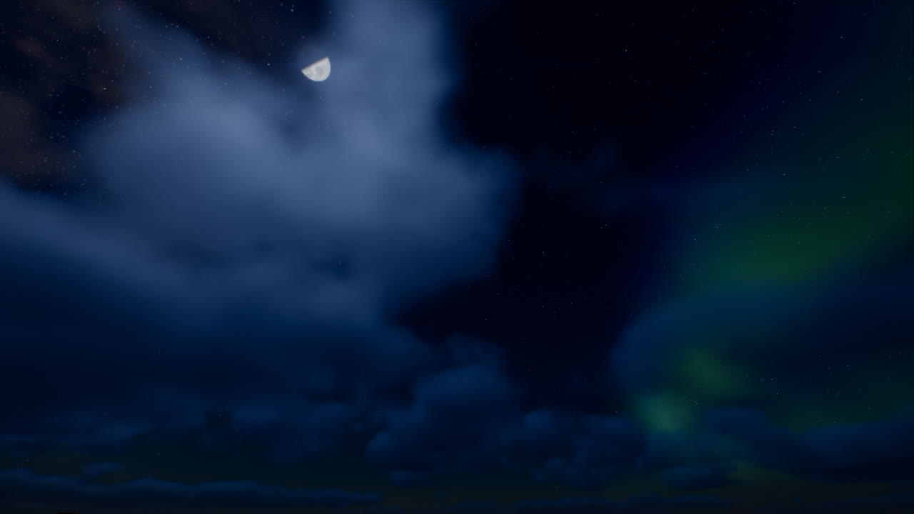 |
| **Northern lights** (on some nights) | **Night sky**: round moon with phases, stars |
| 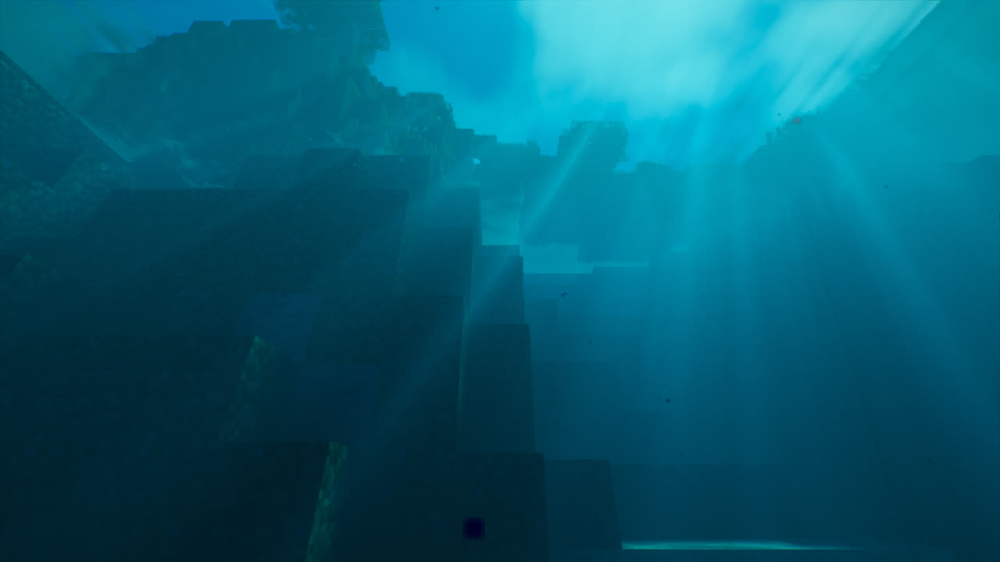 | 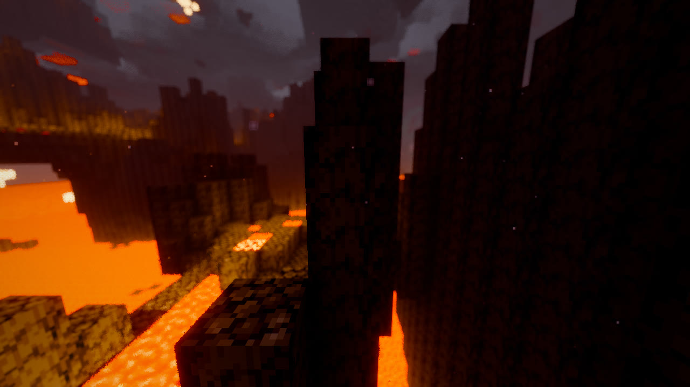 |
| **Underwater**: light shafts through the waves | **Nether**: lava lake, rising smoke, inky shadows |
| 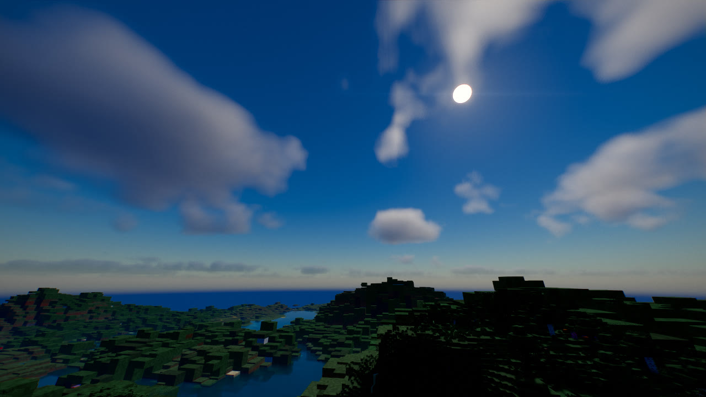 | 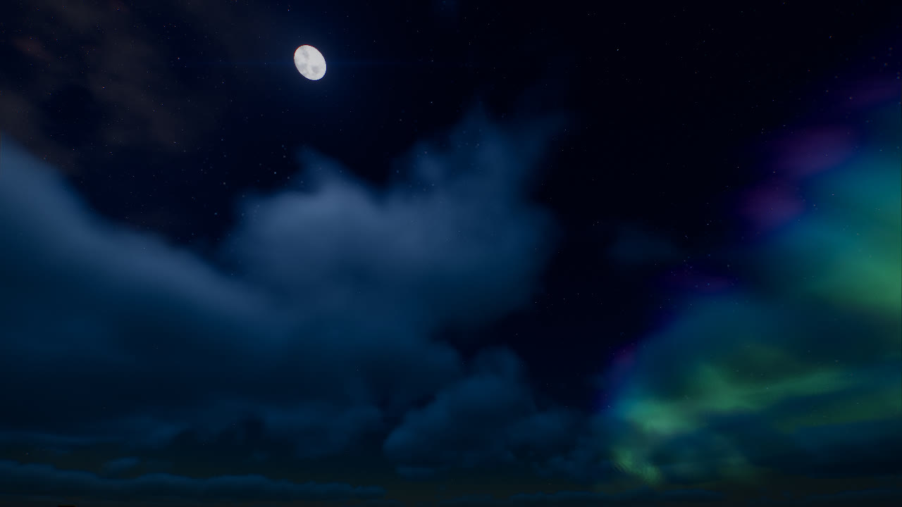 |
| **Round sun** with a soft corona | **Full moon** with craters and maria |

---

## Features

### 🎥 Camera & Film
- **Film curve** options: AgX Punchy (default), ACES or Uchimura
- **"Brand New Day" colour grade** (default), inspired by the look of *Spider-Man: Brand New Day*: classic print film curve, **inky blacks**, saturated reds and blues, restrained greens, cool shadows and warm highlights
- Other grades: *Blockbuster* (teal & orange), *Moody*, *Golden Hour*, *Neutral*
- **Depth of field** like a cinema camera (focus on the centre of the screen, close objects or the background go soft)
- Bloom with reddish film halation, **anamorphic lens flare** with a sun occlusion test
- Vignette, film grain, subtle chromatic aberration, optional **letterbox** (2.39:1 / 1.85:1)
- **TAA** with sharpening and **auto exposure** that deliberately keeps nights dark

### ☀️ Light & Shadow
- Soft shadows that get softer the further they fall from the caster (Vogel PCF)
- **Coloured shadows** through stained glass
- Translucent leaves and grass when backlit (subsurface scattering)
- Warm torch light with an adjustable colour temperature in Kelvin
- Specular highlights on metal and polished blocks

### 🌅 Sky & Atmosphere
- **Physically based sky** (Rayleigh, Mie and ozone) with real sunrises and sunsets
- **Volumetric clouds** with silver linings that get denser and darker in rain
- **Height fog**, distant haze and **morning/evening mist** near the ground
- **God rays** in the fog with real shadows

### 🌌 Night Sky
- Dark starry sky with three star layers, different colour temperatures and twinkling
- **Milky Way** with dust lanes and nebula patches
- The stars rotate with the sky
- **Round sun** with limb darkening and corona, **round moon** with craters and the real moon phases (instead of the blocky vanilla textures)
- **Shooting stars**
- **Northern lights** on about 30% of nights (adjustable), also reflected in water

### 🌧️ Rain
- Thin, almost transparent rain streaks that glow when backlit and turn warm near torches
- **Wet surfaces and puddles** with reflections
- **Raindrop ripples** on puddles and water
- **Rain curtains** drifting through the distance
- **Lightning** lights up the sky, clouds and landscape
- Automatic **rainy film mood**: cooler, less saturated, a little more contrast

### 🌊 Water
- Procedural waves, refraction and absorption: clear water that turns blue-green with depth
- Screen-space reflections with sky fallback and sun glitter
- **Caustics**: the moving web of light on the bottom
- **Underwater light shafts** formed by the waves. Boats and terrain cast shadows into the shafts.

### 🔥 Heat
- **Heat shimmer** rising above lava, fire, magma, campfires and furnaces
- **Nether smoke**: volumetric, slowly rising smoke lit orange from below (similar to the "Nether Storm" in Complementary Unbound)
- **Waving lava**: the lava surface slowly heaves
- In the Nether the distance shimmers and the fog above the lava ocean glows orange

### 🏔️ Distant Horizons
- LODs get the same lighting, fog, clouds and TAA
- Soft, dithered transition between regular chunks and LODs
- Distant mountains fade into the haze

---

## Installation

1. Download the latest `ChopzCinema-vX.Y.zip` from [Releases](../../releases).
2. **Don't unzip it.** Put the ZIP into `.minecraft/shaderpacks/`.
3. In game: *Options → Video Settings → Shader Packs → ChopzCinema*.
4. Pick a profile in the shader menu: **LOW / MEDIUM / HIGH / ULTRA** (default: HIGH).

### Compatibility
| | Version |
|---|---|
| Minecraft | 1.20.1 |
| Forge | Oculus 1.8.0+ with Embeddium |
| Fabric | Iris 1.7+ with Sodium |
| Distant Horizons | 2.2+ / 3.x (optional) |
| OptiFine | not supported (no DH support) |

### Tips
- For the real cinema format, enable **Letterbox 2.39:1** under *Camera & Film*.
- If the depth of field is too strong or too weak, adjust it under *Camera & Film → Depth of Field Strength*.
- Sun and moon size can be changed under *Night Sky*.

### Performance tips
- The biggest levers are **shadow resolution**, **cloud quality** and **god ray quality**.
- Clouds, god rays and Nether smoke already render at half resolution.
- With Distant Horizons, most of the cost comes from the LOD distance itself. The per-pixel shader cost stays the same.

---

## Settings

The menu is available in **English** and **German**:

| Page | Contents |
|---|---|
| Camera & Film | Exposure, film curve, grade, bloom, lens flare, depth of field, vignette, grain, letterbox, TAA |
| Sky, Clouds & Fog | Clouds (quality, height, thickness, coverage), god rays, fog, morning mist, cave fog |
| Night Sky | Round sun & moon (size), stars, Milky Way, shooting stars, northern lights (off / some nights / every night) |
| Lighting | Sun, sky light, night, torch light and colour temperature |
| Shadows | Resolution, distance, softness, coloured shadows, sun angle |
| Water & Reflections | Waves, clarity, caustics, underwater rays, reflections |
| Rain | Rain streaks, raindrop ripples, puddles, rain curtains, lightning, film mood |
| Heat | Heat shimmer, Nether shimmer, lava glow, Nether smoke, waving lava |
| Waving | Waving plants and leaves |

---

## Technical overview

```
shadow      → shadow map (+ water surface for caustics)
gbuffers    → G-buffer (albedo, normals, lightmap, material) – including dh_terrain
deferred    → volumetric clouds (½ resolution)
deferred1   → lighting, sky, sun & moon, stars, northern lights, clouds
forward     → water, glass, particles, rain, hand
composite   → refraction, water absorption, reflections, puddles
composite1  → god rays / underwater rays / Nether smoke (½ resolution)
composite2  → fog, rain curtains, Nether glow
composite3  → TAA + auto exposure
final       → heat shimmer, depth of field, bloom, lens flare, film curve, grade, film effects
```

```
shaders/
  shaders.properties   menu, profiles, blend modes
  block.properties     material ids (leaves, glass, metal, light sources, lava, …)
  lib/                 shared code (sky, night sky, clouds, fog, rain, water, lighting, post)
  program/             programs
  world0|world-1|world1 generated per-dimension wrappers
  lang/                English / German
tools_gen_wrappers.py  regenerates the wrappers
```

---

## Feedback

Please report problems as an issue and attach:
- `.minecraft/logs/latest.log`
- screenshot(s)
- the profile you used and your graphics card
