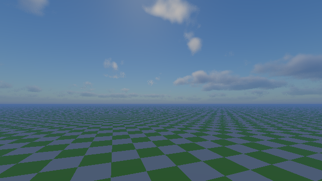
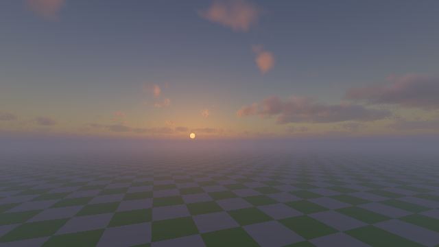
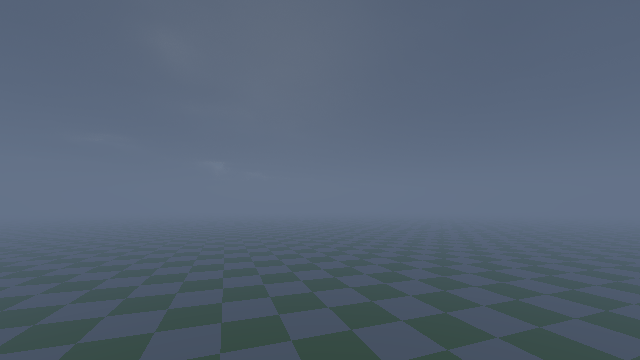
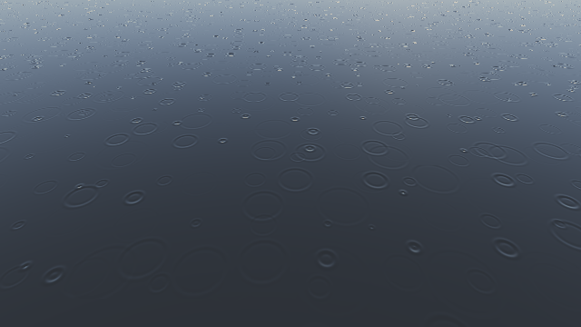
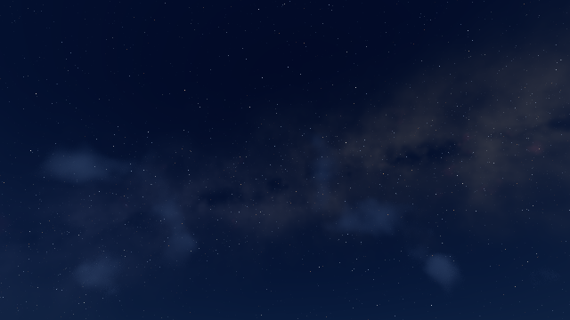
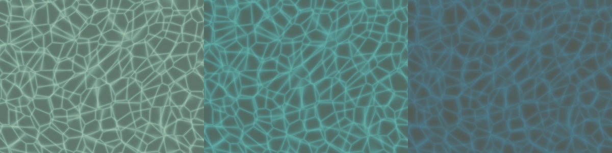

# 🎬 ChopzCinema Shaders

**Cineastischer Shader für Minecraft 1.20.1, gemacht für Oculus/Iris und Distant Horizons.**

ChopzCinema soll Minecraft wie einen Kinofilm aussehen lassen: starkes Licht- und Schattenspiel, Teal-&-Orange-Grading wie in modernen Blockbustern, volumetrische Wolken, Nebel, Lichtstrahlen, ein echter Sternenhimmel mit Polarlichtern und Regen, der sich nach Film anfühlt.

> **Status:** v0.4, Entwicklungsversion. Alle Shader-Programme kompilieren für Overworld, Nether und End mit einem echten OpenGL-Compiler. Ingame-Screenshots folgen.

---

## Vorschau

> Diese Bilder kommen aus dem Test-Renderer des Projekts. Er verwendet denselben Shader-Code für Himmel, Wolken, Wasser und Farbgebung wie das Spiel, rendert aber nur eine Testebene statt einer Minecraft-Welt. Echte Ingame-Screenshots kommen unter [Screenshots aus dem Spiel](#screenshots-aus-dem-spiel) dazu.

| Tag | Sonnenuntergang |
|---|---|
|  |  |
| **Regen** | **Regentropfen auf einer Pfütze** |
|  |  |
| **Sternenhimmel mit Milchstraße** | **Polarlichter** |
|  |  |

**Kaustiken unter Wasser** (1,5 / 4 / 10 Blöcke tief):



## Screenshots aus dem Spiel

*Folgen. Geplant: Wald bei Sonnenaufgang mit Nebel und Lichtstrahlen, Fernsicht mit Distant Horizons, Gewitter im Dorf, Unterwasser, Lavasee im Nether, Polarlichter über einem See.*

---

## Features

### 🎥 Kamera & Film
- **Filmkurve** zur Auswahl: AgX Punchy (Standard), ACES oder Uchimura
- **Color Grading** zur Auswahl: *Blockbuster* (Teal & Orange), *Düster*, *Goldene Stunde* oder *Neutral*
- Bloom mit warmem Film-Glühen (Halation), **anamorphotischer Lens Flare** mit Sonnen-Verdeckungstest
- Vignette, Filmkorn, leichte chromatische Aberration, optionale **Kinobalken** (2.39:1 / 1.85:1)
- **TAA** mit Nachschärfen und **automatische Belichtung**, die Nächte bewusst dunkel lässt

### ☀️ Licht & Schatten
- Weiche Schatten, die mit dem Abstand zum Schattenwerfer weicher werden (Vogel-PCF)
- **Farbige Schatten** durch Buntglas
- Durchscheinende Blätter und Gras im Gegenlicht (Subsurface Scattering)
- Warmes Fackellicht, die Farbtemperatur ist in Kelvin einstellbar
- Glanzlichter auf Metall und polierten Blöcken

### 🌅 Himmel & Atmosphäre
- **Physikalischer Himmel** (Rayleigh, Mie und Ozon) mit echten Sonnenauf- und -untergängen
- **Volumetrische Wolken** mit Silberrändern, bei Regen dichter und dunkler
- **Höhennebel**, Dunst in der Ferne und **Morgen- und Abendnebel** über dem Boden
- **Lichtstrahlen (God Rays)** im Nebel mit echten Schatten

### 🌌 Nachthimmel
- Dunkler Sternenhimmel mit drei Sternebenen, unterschiedlichen Farbtemperaturen und Funkeln
- **Milchstraße** mit Staubbändern und Nebelflecken
- Die Sterne drehen sich mit dem Himmel
- **Sternschnuppen**
- **Polarlichter** in etwa 30 % der Nächte (einstellbar), sie spiegeln sich auch im Wasser

### 🌧️ Regen
- Dünne, fast durchsichtige Regenschlieren, die im Gegenlicht leuchten und an Fackeln warm werden
- **Nasse Oberflächen und Pfützen** mit Spiegelungen
- **Regentropfen-Ringe** auf Pfützen und Wasser
- **Regenschleier**, die in der Ferne vorbeiziehen
- **Blitze** erhellen Himmel, Wolken und Landschaft
- Automatische **Regen-Filmstimmung**: kühler, entsättigter, etwas mehr Kontrast

### 🌊 Wasser
- Prozedurale Wellen, Lichtbrechung und Absorption, also klares Wasser, das mit der Tiefe blaugrün wird
- Screen-Space-Reflexionen mit Himmel als Rückfall und Sonnenglitzern
- **Kaustiken**: das bewegte Lichtnetz am Grund
- **Lichtstrahlen unter Wasser**, die aus den Wellen entstehen. Boote und Terrain werfen Schatten in die Strahlen.

### 🔥 Hitze
- **Hitzeflimmern** steigt über Lava, Feuer, Magma, Lagerfeuern und Öfen auf
- Im Nether flimmert die Ferne, und der Nebel über dem Lavameer glüht orange

### 🏔️ Distant Horizons
- LODs bekommen dieselbe Beleuchtung, denselben Nebel, dieselben Wolken und dasselbe TAA
- Weicher, gedithereter Übergang zwischen normalen Chunks und LODs
- Ferne Berge verschwinden im Dunst

---

## Installation

1. Die neueste `ChopzCinema-vX.Y.zip` unter [Releases](../../releases) herunterladen.
2. Die ZIP **nicht entpacken**, sondern nach `.minecraft/shaderpacks/` legen.
3. Im Spiel: *Optionen → Grafik → Shader-Pakete → ChopzCinema*.
4. Im Shader-Menü ein Profil wählen: **LOW / MEDIUM / HIGH / ULTRA** (Standard: HIGH).

### Kompatibilität
| | Version |
|---|---|
| Minecraft | 1.20.1 |
| Forge | Oculus 1.8.0+ und Embeddium |
| Fabric | Iris 1.7+ und Sodium |
| Distant Horizons | 2.2+ / 3.x (optional) |
| OptiFine | nicht unterstützt (kein DH-Support) |

### Performance-Tipps
- Die größten Stellschrauben sind **Schattenauflösung**, **Wolkenqualität** und **Lichtstrahlen-Qualität**.
- Wolken und Lichtstrahlen werden ohnehin in halber Auflösung berechnet.
- Mit Distant Horizons kostet vor allem die LOD-Distanz selbst. Der Shader-Aufwand pro Pixel bleibt gleich.

---

## Einstellungen

Das Menü gibt es auf **Deutsch** und Englisch:

| Seite | Inhalt |
|---|---|
| Kamera & Film | Belichtung, Filmkurve, Grading, Bloom, Lens Flare, Vignette, Korn, Kinobalken, TAA |
| Himmel, Wolken & Nebel | Wolken (Qualität, Höhe, Dicke, Bedeckung), Lichtstrahlen, Nebel, Morgennebel, Höhlennebel |
| Nachthimmel | Sterne, Milchstraße, Sternschnuppen, Polarlichter (aus / manche Nächte / jede Nacht) |
| Beleuchtung | Sonne, Himmelslicht, Nacht, Fackellicht und Farbtemperatur |
| Schatten | Auflösung, Distanz, Weichheit, farbige Schatten, Sonnenwinkel |
| Wasser & Reflexionen | Wellen, Klarheit, Kaustiken, Unterwasser-Strahlen, Reflexionen |
| Regen | Regenschlieren, Tropfen-Ringe, Pfützen, Regenschleier, Blitze, Filmstimmung |
| Hitze | Hitzeflimmern, Nether-Flimmern, Lava-Glühen |
| Wind | wehende Pflanzen und Blätter |

---

## Technik

```
shadow      → Shadow Map (+ Wasseroberfläche für Kaustiken)
gbuffers    → G-Buffer (Albedo, Normalen, Lightmap, Material) – auch dh_terrain
deferred    → volumetrische Wolken (½ Auflösung)
deferred1   → Beleuchtung, Himmel, Sterne, Polarlichter, Wolken
forward     → Wasser, Glas, Partikel, Regen, Hand
composite   → Lichtbrechung, Wasser-Absorption, Reflexionen, Pfützen
composite1  → Lichtstrahlen / Unterwasser-Strahlen (½ Auflösung)
composite2  → Nebel, Regenschleier, Nether-Glühen
composite3  → TAA + Auto-Belichtung
final       → Hitzeflimmern, Bloom, Lens Flare, Filmkurve, Grading, Film-Effekte
```

```
shaders/
  shaders.properties   Menü, Profile, Blend-Modi
  block.properties     Material-IDs (Blätter, Glas, Metall, Lichtquellen, Lava, …)
  lib/                 gemeinsamer Code (Himmel, Nachthimmel, Wolken, Nebel, Regen, Wasser, Licht, Post)
  program/             Programme
  world0|world-1|world1 automatisch erzeugte Wrapper je Dimension
  lang/                Deutsch / Englisch
tools_gen_wrappers.py  erzeugt die Wrapper neu
```

---

## Feedback

Probleme bitte als Issue melden und dazu anhängen:
- `.minecraft/logs/latest.log`
- Screenshot(s)
- verwendetes Profil und Grafikkarte
