# 🎬 ChopzCinema Shaders

**Cinematic shaderpacks for Minecraft 1.20.1, made for Oculus/Iris and Distant Horizons. Two editions from one codebase:**

| | **ChopzCinema** | **ChopzCinema Story** |
|---|---|---|
| Inspiration | *Spider-Man: Brand New Day*: modern blockbuster | *Ghost of Tsushima*: painterly samurai epic |
| Look | Inky blacks, print film curve, saturated reds & blues, crisp | Lush saturated nature, golden light, soft violet shadows, painted |
| Atmosphere | Clear, physically based haze, dramatic contrast | Golden coloured haze, layered mist, glowing dusks |
| Extras | Depth of field, anamorphic flare, film grain | Painterly brush filter, falling leaves & petals, strong wind gusts |
| Download | `ChopzCinema-vX.Y.zip` | `ChopzCinema-Story-vX.Y.zip` |

> **Status:** v0.8, in development. Tested in-game with Forge 47.4.20, Oculus 1.8.0, Embeddium 0.3.31 and Distant Horizons 3.2.0 in a freshly generated world. Every screenshot below was taken during those tests (F2, default settings, Distant Horizons enabled).

---

## 🎥 ChopzCinema

*The cinematic edition: grounded, high-contrast and filmic, inspired by the look of Spider-Man: Brand New Day.*

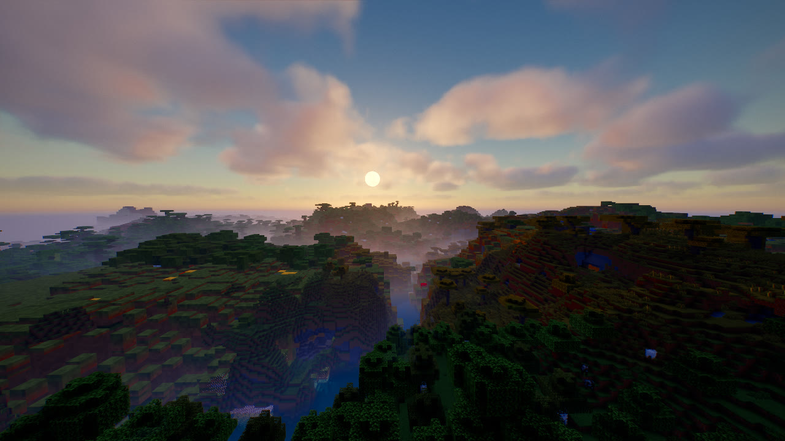
*Golden hour: warm glow, mist in the valley, deep shadows*

| | |
|---|---|
| 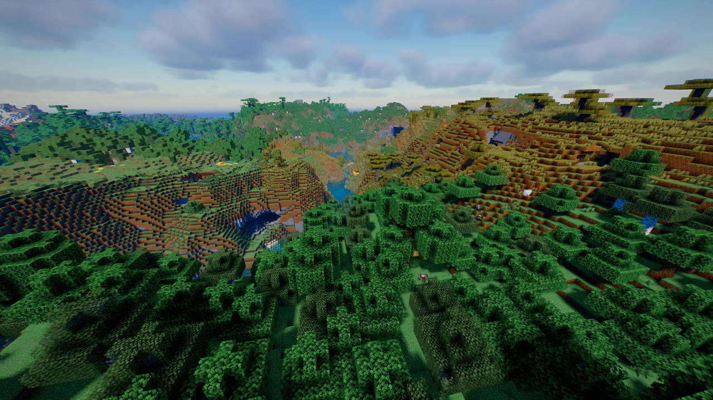 | 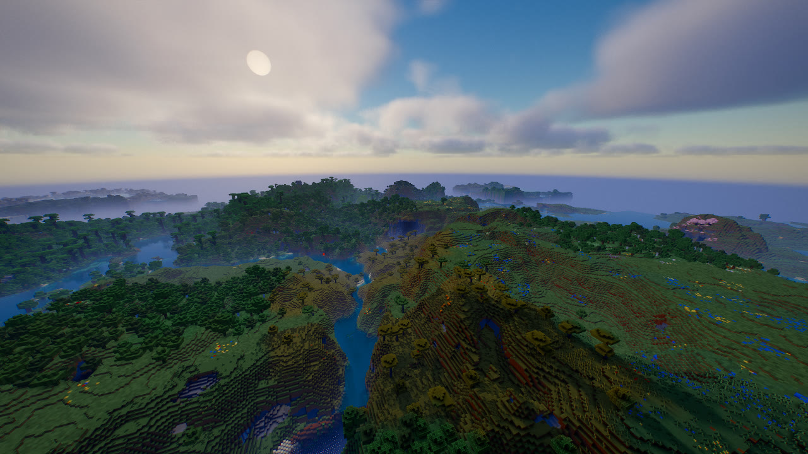 |
| **Day**: strong sun, readable shadows | **Distant Horizons**: clear view to the horizon |
| 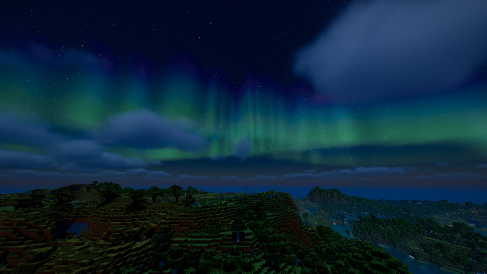 | 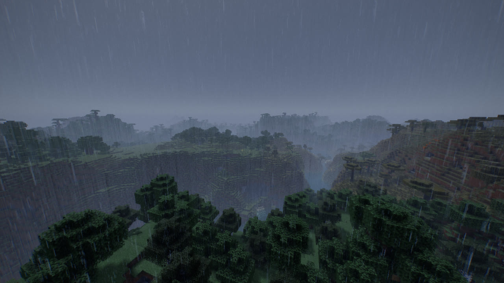 |
| **Night**: northern lights, moonlit landscape | **Thunderstorm**: rain streaks and curtains |
| 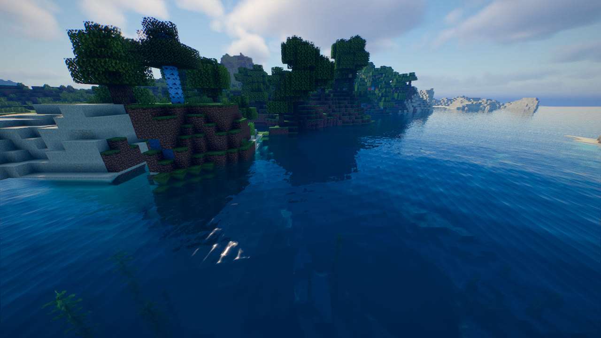 | 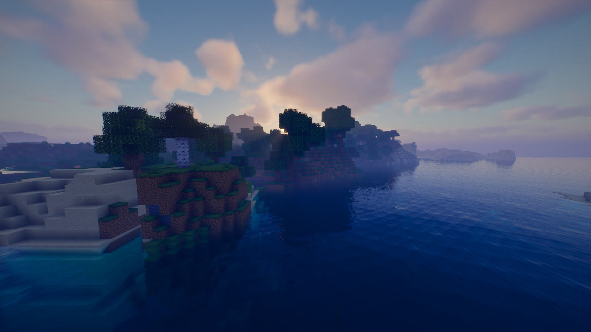 |
| **Water**: clear, reflective, sun glitter | **Water at sunset** |
|  | 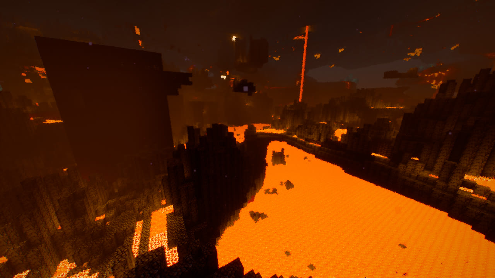 |
| **Underwater**: light shafts through the waves | **Nether**: lava lake, rising smoke, inky shadows |
| 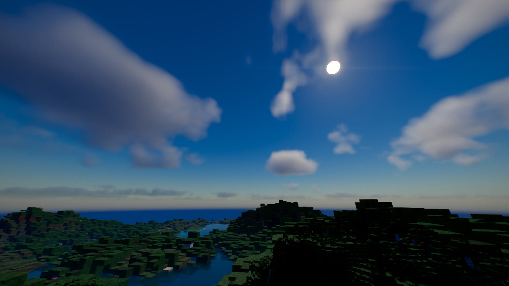 |  |
| **Round sun** with soft corona | **Full moon** with craters and phases |

---

## 🌸 ChopzCinema Story

*The painterly edition: all-in on the Ghost of Tsushima look. Saturated nature, golden light, coloured haze, wind and leaves everywhere.*

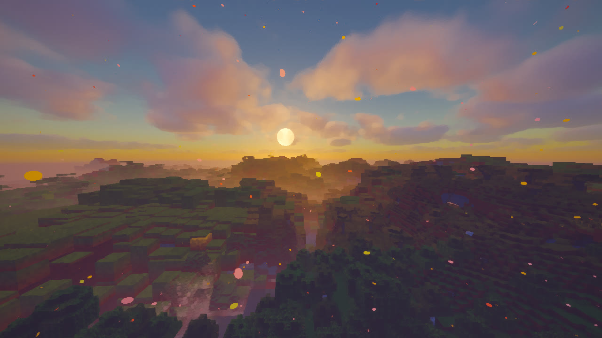
*Dusk in Story: glowing haze, painted light, big warm sun*

| | |
|---|---|
| 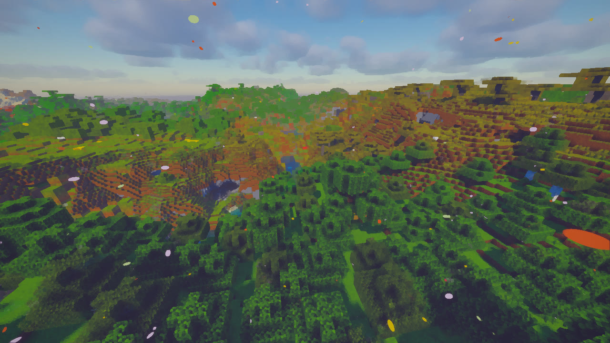 | 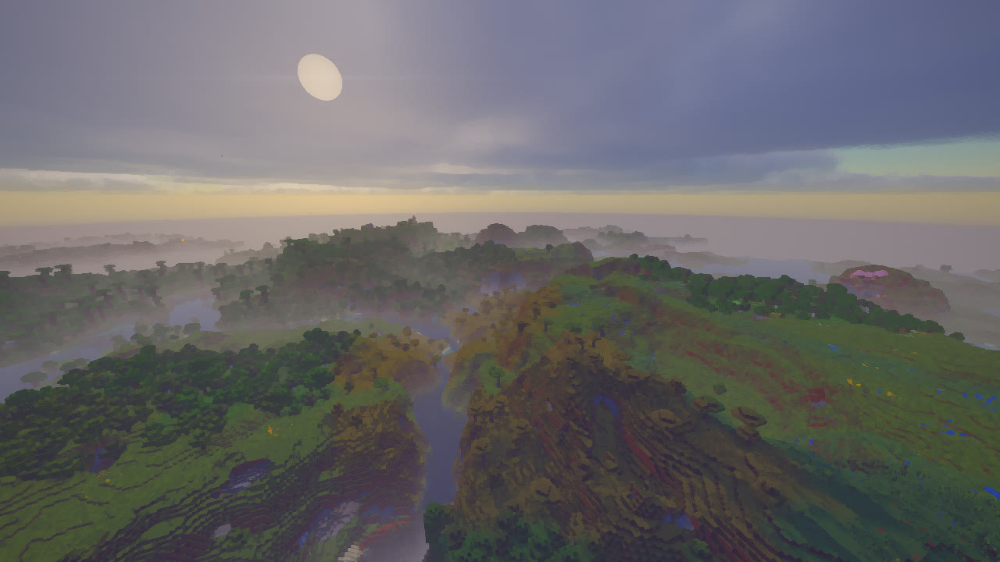 |
| **Day**: lush greens, golden hills, soft shadows | **Distant view**: layered mist like an ink painting |
| 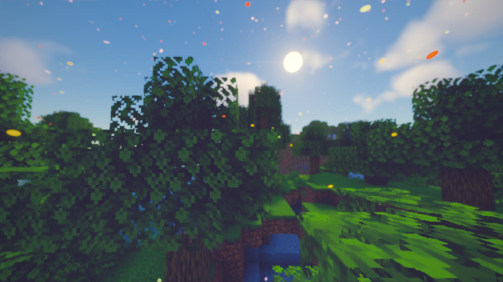 | 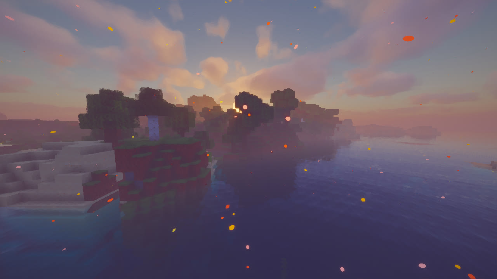 |
| **Forest**: falling leaves and petals, painterly filter | **Coast at dusk**: warm haze, drifting leaves |
| 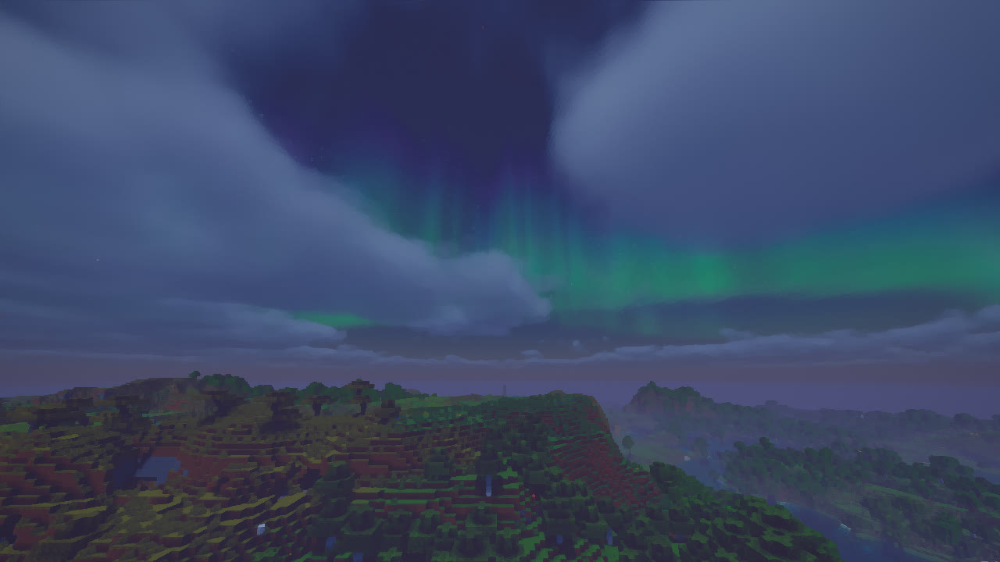 | 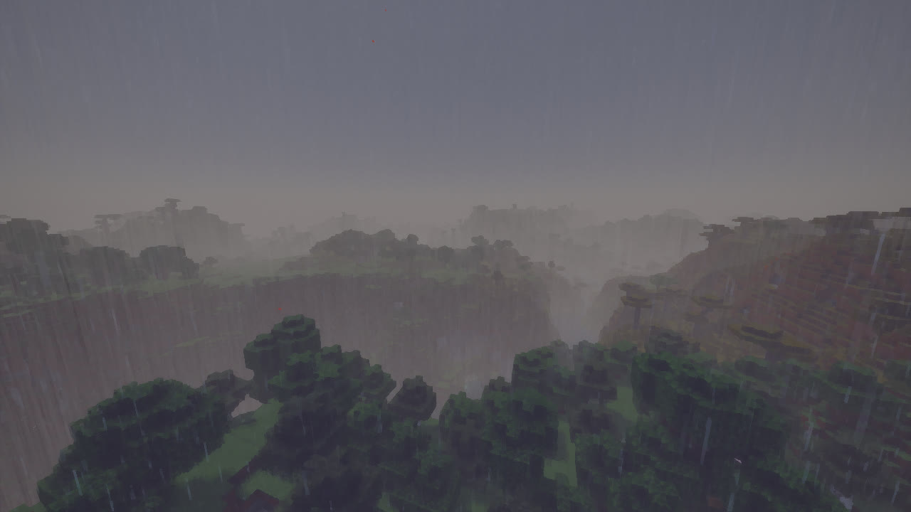 |
| **Night**: blue-violet moonlight, northern lights | **Storm**: soft, misty, painted |
| 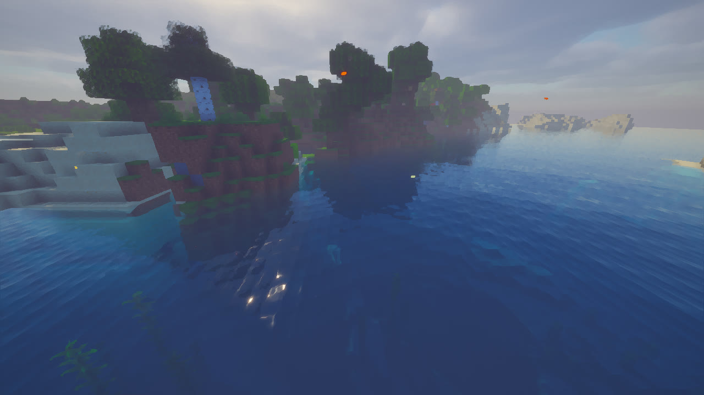 | 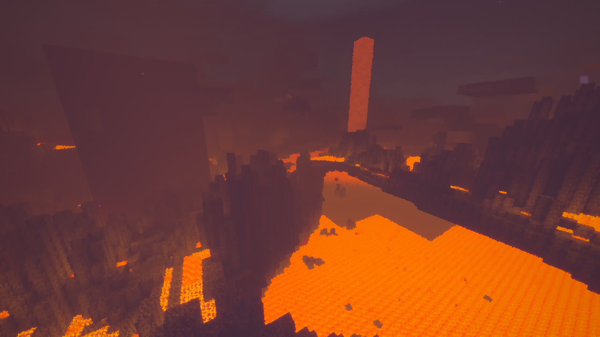 |
| **Water** | **Nether**: warm and painterly |

---

## Features (both editions)

### 🎥 Camera & Film
- **Film curve** options: AgX Punchy (default), ACES or Uchimura
- **Colour grades**: *Brand New Day* (Cinema default), *Tsushima* (Story default), *Blockbuster* (teal & orange), *Moody*, *Golden Hour*, *Neutral*
- **Depth of field** like a cinema camera
- Bloom with film halation, **anamorphic lens flare** with a sun occlusion test
- Vignette, film grain, subtle chromatic aberration, optional **letterbox** (2.39:1 / 1.85:1)
- **TAA** with sharpening and **auto exposure**
- **Kurosawa mode**: black & white samurai film look with hard contrast and heavy grain

### 🌸 Story look (on by default in Story, optional in Cinema)
- **Painterly filter**: an edge-preserving brush-stroke filter that turns surfaces into painted colour areas
- **Falling leaves & petals**: cherry petals, red maple and golden leaves drifting on the wind, anchored in the world
- **Wind gusts**: visible gust fronts roll across grass and trees and bend everything one way
- **Golden coloured haze**: warm aerial perspective by day, glowing orange at dusk, violet at night

### ☀️ Light & Shadow
- Soft shadows that get softer the further they fall from the caster (Vogel PCF)
- **Coloured shadows** through stained glass
- Translucent leaves and grass when backlit (subsurface scattering)
- Warm torch light with an adjustable colour temperature
- Specular highlights on metal and polished blocks

### 🌅 Sky & Atmosphere
- **Physically based sky** (Rayleigh, Mie and ozone) with real sunrises and sunsets
- **Golden hour**: warm glow around a low sun and golden light in the haze
- **Volumetric clouds** with silver linings that get denser and darker in rain
- **Height fog**, distant haze and **morning/evening mist**
- **God rays** in the fog with real shadows

### 🌌 Night Sky
- Starry sky with three star layers, colour temperatures and twinkling, rotating with the sky
- **Milky Way** with dust lanes and nebula patches
- **Round sun** and **round moon** with craters and the real moon phases
- **Shooting stars**
- **Northern lights** on about 30% of nights (adjustable), also reflected in water
- Moonlit nights that stay dark but readable

### 🌧️ Rain
- Thin rain streaks that glow when backlit
- **Wet surfaces and puddles** with reflections and **raindrop ripples**
- **Rain curtains** in the distance, **lightning** that lights up the world
- Automatic **rainy film mood**

### 🌊 Water
- Procedural waves, refraction and absorption: clear water that turns deep blue with depth
- Screen-space reflections with sky and moon fallback, sun glitter
- **Caustics** on the bottom and **underwater light shafts**

### 🔥 Heat
- **Heat shimmer** above lava, fire, magma, campfires and furnaces
- **Nether smoke**: volumetric, slowly rising smoke lit orange from below
- **Waving lava** and a glowing lava ocean haze

### 🏔️ Distant Horizons
- LODs get the same lighting, fog, clouds and TAA
- Soft, dithered transition between regular chunks and LODs

---

## Installation

1. Download the edition you want from [Releases](../../releases): `ChopzCinema-vX.Y.zip` and/or `ChopzCinema-Story-vX.Y.zip`. You can install both side by side.
2. **Don't unzip it.** Put the ZIP into `.minecraft/shaderpacks/`.
3. In game: *Options → Video Settings → Shader Packs* and pick the edition.
4. Pick a profile in the shader menu: **LOW / MEDIUM / HIGH / ULTRA** (default: HIGH).

Every option is shared: you can turn the Story features on in ChopzCinema (menu page *Story Look*) or switch Story to the *Brand New Day* grade.

### Compatibility
| | Version |
|---|---|
| Minecraft | 1.20.1 |
| Forge | Oculus 1.8.0+ with Embeddium |
| Fabric | Iris 1.7+ with Sodium |
| Distant Horizons | 2.2+ / 3.x (optional) |
| OptiFine | not supported (no DH support) |

### Tips
- For the real cinema format, enable **Letterbox 2.39:1** under *Camera & Film*.
- Too much or too little depth of field? *Camera & Film → Depth of Field Strength*.
- Sun and moon size: *Night Sky*.
- Painterly filter, leaves and wind strength: *Story Look*.

### Performance tips
- The biggest levers are **shadow resolution**, **cloud quality** and **god ray quality**.
- Clouds, god rays and Nether smoke render at half resolution.
- The painterly filter and falling leaves cost a little extra. Turn them down in *Story Look* if needed.

---

## Settings

The menu is available in **English** and **German**:

| Page | Contents |
|---|---|
| Camera & Film | Exposure, film curve, grade, bloom, lens flare, depth of field, vignette, grain, letterbox, TAA |
| Story Look | Grade, painterly filter, falling leaves, leaves density, wind gusts, wind strength, golden haze, Kurosawa mode |
| Sky, Clouds & Fog | Clouds (quality, height, thickness, coverage), god rays, fog, morning mist, cave fog |
| Night Sky | Round sun & moon (size), stars, Milky Way, shooting stars, northern lights |
| Lighting | Sun, sky light, night, torch light and colour temperature |
| Shadows | Resolution, distance, softness, coloured shadows, sun angle |
| Water & Reflections | Waves, clarity, caustics, underwater rays, reflections |
| Rain | Rain streaks, raindrop ripples, puddles, rain curtains, lightning, film mood |
| Heat | Heat shimmer, Nether shimmer, lava glow, Nether smoke, waving lava |
| Waving | Waving plants and leaves |

---

## Building

Both editions are built from the same `shaders/` folder. The Story edition only changes default values in `shaders/lib/settings.glsl`.

```
python3 tools/build_packs.py v0.8          # -> dist/ChopzCinema-v0.8.zip, dist/ChopzCinema-Story-v0.8.zip
python3 tools/gen_wrappers.py               # regenerate world0/world-1/world1 program wrappers
```

The Story defaults live in `STORY_DEFAULTS` in `tools/build_packs.py`.

## Technical overview

```
shadow      → shadow map (+ water surface for caustics)
gbuffers    → G-buffer (albedo, normals, lightmap, material) – including dh_terrain
deferred    → volumetric clouds (½ resolution)
deferred1   → lighting, sky, sun & moon, stars, northern lights, clouds
forward     → water, glass, particles, rain, hand
composite   → refraction, water absorption, reflections, puddles
composite1  → god rays / underwater rays / Nether smoke (½ resolution)
composite2  → fog, golden haze, rain curtains, falling leaves, Nether glow
composite3  → TAA + auto exposure
final       → heat shimmer, painterly filter, depth of field, bloom, lens flare, film curve, grade, film effects
```

---

## Feedback

Please report problems as an issue and attach:
- `.minecraft/logs/latest.log`
- screenshot(s)
- the edition and profile you used and your graphics card
