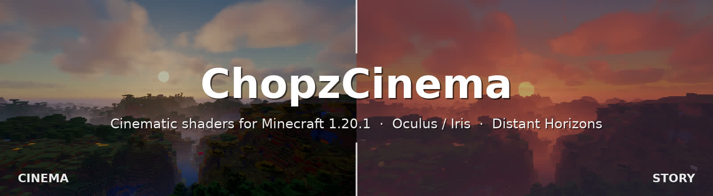

<div align="center">



### Make Minecraft look like a movie.

Two hand-made shader editions for **Minecraft 1.20.1**, one for **blockbuster drama** and one for **painterly samurai poetry**.
Built for **Oculus / Iris** and fully compatible with **Distant Horizons**.

<br>

[](#-installation)
[](#-installation)
[](#-installation)
[](../../releases/latest)

**[⬇️ Download](../../releases/latest)** &nbsp;·&nbsp; **[🎬 Editions](#-two-editions)** &nbsp;·&nbsp; **[🖼️ Gallery](#%EF%B8%8F-gallery)** &nbsp;·&nbsp; **[✨ Features](#-features)** &nbsp;·&nbsp; **[📦 Install](#-installation)**

</div>

---

## 🎬 Two Editions

<table>
<tr>
<td width="50%" valign="top">


### 🎥 ChopzCinema
*Inspired by **Spider-Man: Brand New Day***

Grounded, high contrast, modern blockbuster.

- Classic print film curve with **inky blacks**
- Saturated reds & blues, restrained greens
- Glowing golden hour, moonlit nights
- Depth of field, anamorphic flare, film grain

**`ChopzCinema-vX.Y.zip`**

</td>
<td width="50%" valign="top">


### 🌸 ChopzCinema Story
*Inspired by **Ghost of Tsushima***

Painterly, poetic, all about wind and colour.

- Lush, saturated nature & **painterly brush filter**
- Coral-pink dusks under violet skies
- **Leaves & petals carried by wind gusts**
- Glowing coloured haze, teal-green storms

**`ChopzCinema-Story-vX.Y.zip`**

</td>
</tr>
</table>

> Both editions share the same engine. Every feature can be switched on in either one, so you can mix your own look in the shader menu.

---

## ✨ Highlights

<table>
<tr>
<td width="33%" valign="top">

### 🌅 Living sky
Physically based atmosphere, volumetric clouds, cirrus streaks, real sunsets and a **round sun and moon** with phases.

</td>
<td width="33%" valign="top">

### 🌌 Night magic
A dark starry sky with the **Milky Way**, shooting stars and **northern lights** on some nights.

</td>
<td width="33%" valign="top">

### 🌫️ Atmosphere
Height fog, morning mist, coloured haze and **god rays** with real shadows.

</td>
</tr>
<tr>
<td valign="top">

### 🌊 Water
Clear refractive water, reflections, sun glitter, **caustics** and **underwater light shafts**.

</td>
<td valign="top">

### 🌧️ Cinematic rain
Glowing rain streaks, puddles with ripples, rain curtains and **lightning** that lights the world.

</td>
<td valign="top">

### 🔥 Heat & Nether
Heat shimmer over lava and fire, **volumetric Nether smoke**, waving lava.

</td>
</tr>
<tr>
<td valign="top">

### 🏔️ Distant Horizons
LODs get the same lighting, fog, clouds and TAA, with seamless transitions to the horizon.

</td>
<td valign="top">

### 🎞️ Film camera
AgX/ACES film curves, colour grades, bloom with halation, DOF, lens flare, letterbox, **Kurosawa mode**.

</td>
<td valign="top">

### 🍃 Wind
Waving plants and leaves with visible **gust fronts** rolling across the land.

</td>
</tr>
</table>

---

## 🖼️ Gallery

*All images are real in-game screenshots taken with the default settings and Distant Horizons enabled.*

### 🎥 ChopzCinema

| | |
|:---:|:---:|
|  |  |
| **Day**: strong sun, readable shadows | **Distant Horizons**: clear view to the horizon |
|  |  |
| **Night**: northern lights over a moonlit land | **Thunderstorm**: rain streaks and curtains |
|  |  |
| **Water**: clear, reflective, sun glitter | **Coast at sunset** |
|  |  |
| **Underwater**: light shafts through the waves | **Nether**: lava lake, rising smoke |
|  |  |
| **Round sun** with a soft corona | **Full moon** with craters and phases |

### 🌸 ChopzCinema Story

| | |
|:---:|:---:|
|  |  |
| **Day**: lush greens, golden hills | **Distant view**: layered mist like an ink painting |
|  |  |
| **Morning**: cirrus streaks, painterly light | **Coast at dusk**: pink-violet haze, drifting petals |
|  |  |
| **Night**: blue-violet moonlight, northern lights | **Storm**: teal mist, leaves flying in the wind |
|  |  |
| **Water** | **Nether**: warm and painterly |

---

## ✨ Features

<details open>
<summary><b>🎞️ Camera & Film</b></summary>

- **Film curves**: AgX Punchy (default), ACES, Uchimura
- **Colour grades**: *Brand New Day* (Cinema), *Tsushima* (Story), *Blockbuster*, *Moody*, *Golden Hour*, *Neutral*
- **Depth of field** with a thin-lens model: far scenery stays sharp, close objects go soft
- Bloom with film **halation**, **anamorphic lens flare** with sun occlusion
- Vignette, film grain, chromatic aberration, optional **letterbox** (2.39:1 / 1.85:1)
- **TAA** with sharpening, **auto exposure** that keeps nights dark but readable
- **Kurosawa mode**: black & white samurai film with hard contrast and heavy grain

</details>

<details>
<summary><b>🌸 Story look</b> (default in Story, optional in Cinema)</summary>

- **Painterly filter**: edge-preserving brush strokes
- **Wind-blown leaves & petals**: sparse when calm, bursts in gusts, lots in storms. Mostly green, red petals at dusk. Anchored in the world.
- **Wind gusts**: visible fronts bend grass and trees as they roll across the land
- **Coloured haze**: white-gold by day, glowing pink at dusk, violet at night
- **Tsushima grade**: coral/pink dusks, violet skies, teal-green storms, soft saturation ceiling

</details>

<details>
<summary><b>☀️ Light & Shadow</b></summary>

- Soft shadows that grow softer with distance to the caster
- **Coloured shadows** through stained glass
- Translucent backlit leaves and grass (subsurface scattering)
- Warm torch light with adjustable colour temperature
- Specular highlights on metal and polished blocks

</details>

<details>
<summary><b>🌅 Sky, Night & Weather</b></summary>

- Physically based sky (Rayleigh, Mie, ozone), **golden hour** glow
- **Volumetric clouds** and **cirrus streaks**
- Height fog, distant haze, morning/evening mist, **god rays**
- Three-layer starry sky, **Milky Way**, shooting stars, rotating with the sky
- **Round sun** and **round moon** with craters and real moon phases
- **Northern lights** on ~30% of nights, reflected in water
- Rain streaks, wet surfaces, **puddles with raindrop ripples**, rain curtains, **lightning flashes**, rainy film mood

</details>

<details>
<summary><b>🌊 Water, Heat & Nether</b></summary>

- Procedural waves, refraction, absorption, screen-space reflections, sun glitter
- **Caustics** and **underwater light shafts**
- Heat shimmer over lava, fire, magma, campfires and furnaces
- **Volumetric Nether smoke** lit by the lava ocean, waving lava

</details>

---

## 📦 Installation

1. Grab the edition you like from **[Releases](../../releases/latest)**. You can install both side by side.
2. Drop the **ZIP** (don't unzip it) into `.minecraft/shaderpacks/`.
3. In game: **Options → Video Settings → Shader Packs** and pick **ChopzCinema** or **ChopzCinema-Story**.
4. Choose a profile in the shader menu: **LOW · MEDIUM · HIGH · ULTRA** (default: HIGH).

| Requirement | Version |
|---|---|
| Minecraft | 1.20.1 |
| Forge | Oculus 1.8.0+ with Embeddium |
| Fabric | Iris 1.7+ with Sodium |
| Distant Horizons | 2.2+ / 3.x *(optional)* |
| OptiFine | ❌ not supported |

> ✅ Tested in-game with Forge 47.4.20, Oculus 1.8.0, Embeddium 0.3.31 and Distant Horizons 3.2.0.

<details>
<summary><b>💡 Tips & performance</b></summary>

- For the real cinema format, enable **Letterbox 2.39:1** under *Camera & Film*.
- Depth of field strength: *Camera & Film*. Sun & moon size: *Night Sky*.
- Painterly filter, leaves and wind: *Story Look*.
- Biggest performance levers: **shadow resolution**, **cloud quality**, **god ray quality**.
- Clouds, god rays and Nether smoke already render at half resolution.

</details>

<details>
<summary><b>⚙️ Settings overview</b></summary>

The menu is available in **English** and **German**.

| Page | Contents |
|---|---|
| Camera & Film | Exposure, film curve, grade, bloom, lens flare, depth of field, vignette, grain, letterbox, TAA |
| Story Look | Grade, painterly filter, leaves, leaves density, wind gusts, wind strength, coloured haze, Kurosawa mode |
| Sky, Clouds & Fog | Volumetric clouds, cirrus, god rays, fog, morning mist, cave fog |
| Night Sky | Round sun & moon, stars, Milky Way, shooting stars, northern lights |
| Lighting | Sun, sky light, night, torch light & colour temperature |
| Shadows | Resolution, distance, softness, coloured shadows, sun angle |
| Water & Reflections | Waves, clarity, caustics, underwater rays, reflections |
| Rain | Rain streaks, ripples, puddles, rain curtains, lightning, film mood |
| Heat | Heat shimmer, Nether shimmer, lava glow, Nether smoke, waving lava |
| Waving | Plants and leaves |

</details>

<details>
<summary><b>🛠️ Building & technical overview</b></summary>

Both editions come from the same `shaders/` folder. The Story edition only changes default values (see `STORY_DEFAULTS` in `tools/build_packs.py`).

```bash
python3 tools/build_packs.py v0.9   # -> dist/ChopzCinema-v0.9.zip + dist/ChopzCinema-Story-v0.9.zip
python3 tools/gen_wrappers.py       # regenerate world0 / world-1 / world1 program wrappers
```

```
shadow      → shadow map (+ water surface for caustics)
gbuffers    → G-buffer (albedo, normals, lightmap, material), incl. dh_terrain
deferred    → volumetric clouds (½ res)
deferred1   → lighting, sky, cirrus, sun & moon, stars, northern lights
forward     → water, glass, particles, rain, hand
composite   → refraction, water absorption, reflections, puddles
composite1  → god rays / underwater rays / Nether smoke (½ res)
composite2  → fog, coloured haze, rain curtains, wind-blown leaves
composite3  → TAA + auto exposure
final       → heat shimmer, painterly filter, DOF, bloom, flare, film curve, grade
```

</details>

---

## 💬 Feedback

Found a bug or have an idea? **[Open an issue](../../issues)** and attach your `.minecraft/logs/latest.log`, a screenshot, the edition and profile you used, and your graphics card.

<div align="center">
<sub>ChopzCinema is a fan project and is not affiliated with Mojang, Marvel, Sony or Sucker Punch. <i>Spider-Man: Brand New Day</i> and <i>Ghost of Tsushima</i> are only named as visual inspiration.</sub>
</div>
